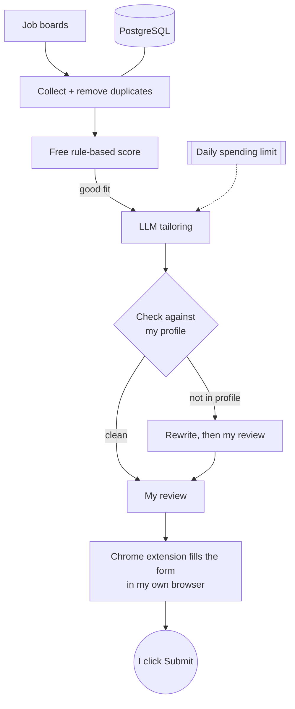

## Deshraj Jogiya

**Data Engineer and Machine Learning Engineer** with an MS in Information Technology from Arizona State University (4.0 GPA).
I build data pipelines, data warehouses and machine learning applications. I'm based in Tempe, Arizona, open to relocation,
and looking for Data Engineer and ML Engineer roles.

[Portfolio](https://deshraj-jogiya.github.io) · [LinkedIn](https://www.linkedin.com/in/deshrajjogiya) ·
[Email](mailto:djogiya786@gmail.com) · [Career Pilot live demo](https://demo.129-146-36-193.sslip.io)

**Core stack:** Python, SQL, PySpark, Airflow, dbt, Snowflake, Databricks, AWS (Glue, S3, Lambda), Great Expectations, FastAPI,
PostgreSQL, scikit-learn, MLflow, LLM APIs.

---

### Experience

| | Role | Results |
|---|---|---|
| **Technoid** | Applied ML Engineer · 2025–26 | Candidate-resume matching accuracy **+25%** (GPT-4o mini, PostgreSQL); vector sync latency **−65%** after restructuring the Supabase sync layer and its row-level security |
| **Zifatech Solutions** | Data Analyst / Data Engineer · 2025 | Multi-source ingestion **60% faster** on AWS Glue, S3 and Lambda orchestrated by Airflow; **98%+** data reliability in Snowflake with Great Expectations; manual sales reporting **−70%** |
| **Arizona State University** | Data Engineer & ML Research Assistant · 2024–25 | Real-time streaming pipeline at **99.9%** uptime for 5,000 concurrent users, throughput **+35%** |
| **Objectways** | Teleoperation Data Collection · 2026– | Dataset accuracy **+20%** across 10,000+ robotics sensor samples used for model training |

---

### Career Pilot: my job-search assistant

I've been searching for a job for more than two years. Tracking postings, tailoring my resume and typing the same answers into
application forms took most of each day, so I built a tool for the repetitive parts. It collects postings, scores how well each one
fits, drafts a tailored resume and cover letter, and pre-fills the application form. I review every application and submit it myself.
[Code](https://github.com/Deshraj-Jogiya/Job-Search-CRM-Automation) · [Live demo](https://demo.129-146-36-193.sslip.io)

**Problems I ran into and how I solved them**
- **The language model sometimes added skills I don't have.** Every generated resume is now compared, by ordinary code, with my
  profile. Anything that isn't in the profile sends the draft back for a rewrite, and if it still doesn't match, it comes to me.
- **An early version spent far more on API calls than I expected.** Each posting now gets a free rule-based score first, only
  promising postings go to the model, and a daily spending limit is checked before every paid call.
- **Employer sites blocked form filling from a cloud server.** Form filling moved into a browser extension that runs in my own
  browser. Testing it on seven applicant-tracking systems turned up form types I hadn't planned for, such as Shadow DOM forms,
  hidden upload fields and decoy fields meant to catch bots, and each one now has a fix.
- **My first location filter wrongly skipped 458 US postings.** It now removes a posting only when its location clearly names
  another country.

Built with FastAPI, PostgreSQL (Supabase), Alembic and a Chrome extension, hosted on an Oracle Cloud VM, with 1,100+ automated tests.

---

### Data engineering

| Project | What it shows | Status |
|---|---|---|
| [Job Market Lakehouse](https://github.com/Deshraj-Jogiya/job-market-lakehouse) | PySpark join, aggregation and `dense_rank()` over 60k postings, 11 Great Expectations data-quality checks on the output, an Airflow DAG and a Scala Spark job |  |
| [Job Search dbt Warehouse](https://github.com/Deshraj-Jogiya/job-search-dbt-warehouse) | Dimensional model on a live Databricks SQL warehouse: date spine, incremental `merge` snapshot, 15 dbt tests including two business-rule tests | dbt run/test in CI |
| [TalentVenue EventIntel](https://github.com/Deshraj-Jogiya/TalentVenue_EventIntel) | Bootcamp capstone on real business data: SQL Server to ADLS Gen2 and Snowflake provisioned with Terraform, Delta and Iceberg tables, a Random Forest (0.87 ROC-AUC) served as a Snowflake UDF |  |
| [Reactive Job Ingest Gateway](https://github.com/Deshraj-Jogiya/reactive-job-ingest-gateway) | Non-blocking ingestion on Spring WebFlux and R2DBC, republished as a live Server-Sent Events stream |  |

### Machine learning and AI

| Project | What it shows | Status |
|---|---|---|
| [AI Model Observability](https://github.com/Deshraj-Jogiya/AI-Model-Observability-Auditing) | KS-test and PSI drift checks plus demographic-parity and equal-opportunity metrics, with a [published Tableau dashboard](https://public.tableau.com/app/profile/deshraj.jogiya/viz/AIModelObservabilityFairnessAuditDashboard) (simulated inference data) |  |
| [FinRisk Analytics Pipeline](https://github.com/Deshraj-Jogiya/FinRisk-Analytics-Pipeline) | FastAPI scoring under 100 ms, Random Forest vs XGBoost compared in MLflow (Random Forest kept at 92% precision), fraud rules and a GraphQL layer |  |
| [Member Messages QA](https://github.com/Deshraj-Jogiya/NLP-based-Q-A-system) | Semantic search with sentence embeddings, spaCy entity detection, a LlamaIndex retriever and a LangChain RAG chain behind a FastAPI endpoint |  |
| [Sentence Transformers + LoRA](https://github.com/Deshraj-Jogiya/sentence-transformers-llm-finetuning) | Multi-task heads on a Small BERT backbone, and LoRA fine-tuning of Qwen2.5-0.5B on a free Colab GPU |  |
| [CurioSync](https://github.com/Deshraj-Jogiya/curiosync) | GitHub Actions pipeline that drafts LinkedIn posts only from my own project data; mechanical checks and a second model pass reject invented claims |  |

My analytics and full-stack projects are on my [portfolio](https://deshraj-jogiya.github.io).

---

### About these repositories

Each repository has a README with an overview, an architecture diagram and the commands to run it. Projects built on synthetic or
simulated data say so in their README. If you have questions or feedback on any of them, I'd be glad to hear from you on
[LinkedIn](https://www.linkedin.com/in/deshrajjogiya) or by [email](mailto:djogiya786@gmail.com).
