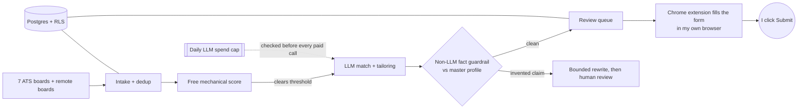

## Deshraj Jogiya

**Data Engineer and Machine Learning Engineer.** I build pipelines and warehouses that people can trust, and AI systems that are
checked before anything they produce reaches a person. MS in Information Technology, Arizona State University (4.0 GPA).
Based in Tempe, Arizona, open to relocation, looking for Data Engineer and ML Engineer roles.

[Portfolio](https://deshraj-jogiya.github.io) · [LinkedIn](https://www.linkedin.com/in/deshrajjogiya) ·
[Email](mailto:djogiya786@gmail.com) · [Career Pilot live demo](https://demo.129-146-36-193.sslip.io)

**Core stack:** Python, SQL, PySpark, Airflow, dbt, Snowflake, Databricks, AWS (Glue, S3, Lambda), Great Expectations, FastAPI,
PostgreSQL, scikit-learn, MLflow, LLM APIs.

---

### At work

| | Role | What changed because of my work |
|---|---|---|
| **Technoid** | Applied ML Engineer · 2025–26 | Candidate-resume matching accuracy **+25%** (GPT-4o mini, PostgreSQL); vector sync latency **−65%** after restructuring the Supabase sync layer and its row-level security |
| **Zifatech Solutions** | Data Analyst / Data Engineer · 2025 | Multi-source ingestion **60% faster** on AWS Glue, S3 and Lambda orchestrated by Airflow; **98%+** data reliability in Snowflake with Great Expectations; manual sales reporting **−70%** |
| **Arizona State University** | Data Engineer & ML Research Assistant · 2024–25 | Real-time streaming pipeline at **99.9%** uptime for 5,000 concurrent users, throughput **+35%** |
| **Objectways** | Teleoperation Data Collection · 2026– | Dataset accuracy **+20%** across 10,000+ robotics sensor samples used for model training |

---

### Career Pilot: the system I run every day

I spent more than two years searching for a job and found most tools either fake their results or break. So I built my own and put
it in production: it finds postings, scores them, tailors my resume per posting with an LLM, and pre-fills applications. **Nothing
is ever submitted or sent without my click.**
[Code](https://github.com/Deshraj-Jogiya/Job-Search-CRM-Automation) · [Live demo](https://demo.129-146-36-193.sslip.io)

**Decisions that shaped it**
- **The model is never trusted with facts.** Every tailored resume is checked by plain code against my master profile; a skill or
  number that isn't there blocks the document. It gets two corrective rewrites, then goes to me.
- **Pay for the LLM last.** A free mechanical score runs first, so postings that can't clear the bar never cost an API call. After
  an early rollout overspent, I added a hard daily spend cap checked before every metered call.
- **Fill forms in the user's browser, not on a server.** Server-side Playwright on a cloud VM was blocked by employers' bot
  protection (5 of 5 attempts, 0 fields filled). The extension runs in my own browser and asks the backend for answers, so the
  answering logic exists once. Live testing on all 7 ATS platforms found real breakage: Shadow DOM forms, honeypot fields,
  react-select widgets, hidden file inputs.
- **Filters fail open.** An allow-list location filter wrongly skipped 458 US postings on its first live run. I rewrote it to
  exclude only on a positive match against a known foreign location.

FastAPI · PostgreSQL (Supabase, row-level security on every table) · Alembic · Oracle Cloud VM + Caddy · 1,100+ pytest tests in CI

---

### Data engineering

| Project | What it shows | Status |
|---|---|---|
| [Job Market Lakehouse](https://github.com/Deshraj-Jogiya/job-market-lakehouse) | PySpark join, aggregation and `dense_rank()` over 60k postings, 11 Great Expectations checks that fail the run, an Airflow DAG run end to end, and a Scala Spark job |  |
| [Job Search dbt Warehouse](https://github.com/Deshraj-Jogiya/job-search-dbt-warehouse) | Dimensional model on a live Databricks SQL warehouse: date spine, incremental `merge` snapshot, 15 dbt tests including two business-rule tests | dbt run/test in CI |
| [TalentVenue EventIntel](https://github.com/Deshraj-Jogiya/TalentVenue_EventIntel) | Bootcamp capstone on real business data: SQL Server to ADLS Gen2 and Snowflake provisioned with Terraform, Delta and Iceberg tables, a Random Forest (0.87 ROC-AUC) served as a Snowflake UDF |  |
| [Reactive Job Ingest Gateway](https://github.com/Deshraj-Jogiya/reactive-job-ingest-gateway) | Non-blocking ingestion on Spring WebFlux and R2DBC, republished as a live Server-Sent Events stream |  |

### Machine learning and AI

| Project | What it shows | Status |
|---|---|---|
| [AI Model Observability](https://github.com/Deshraj-Jogiya/AI-Model-Observability-Auditing) | KS-test and PSI drift checks plus demographic-parity and equal-opportunity metrics, with a [published Tableau dashboard](https://public.tableau.com/app/profile/deshraj.jogiya/viz/AIModelObservabilityFairnessAuditDashboard) (simulated inference data) |  |
| [FinRisk Analytics Pipeline](https://github.com/Deshraj-Jogiya/FinRisk-Analytics-Pipeline) | FastAPI scoring under 100 ms, Random Forest vs XGBoost compared in MLflow (Random Forest kept at 92% precision), fraud rules and a GraphQL layer |  |
| [Member Messages QA](https://github.com/Deshraj-Jogiya/NLP-based-Q-A-system) | Semantic search with sentence embeddings, spaCy entity detection, a LlamaIndex retriever and a LangChain RAG chain behind a FastAPI endpoint |  |
| [Sentence Transformers + LoRA](https://github.com/Deshraj-Jogiya/sentence-transformers-llm-finetuning) | Multi-task heads on a Small BERT backbone, and LoRA fine-tuning of Qwen2.5-0.5B on a free Colab GPU |  |
| [CurioSync](https://github.com/Deshraj-Jogiya/curiosync) | GitHub Actions pipeline that drafts LinkedIn posts only from my own project data; mechanical checks and a second model pass reject invented claims |  |

All projects, including analytics and full-stack work, are on my [portfolio](https://deshraj-jogiya.github.io).

---

### How I work

- **Tests run in CI on every repo I list here**, and a failing check stops the pipeline instead of logging a warning.
- **Data is labeled honestly.** When a project uses synthetic or simulated data, its README says so.
- **I verify against the real thing.** The dbt models run on a live warehouse, the ArcGIS tests call the live APIs, and the extension
  was tested on real application forms, because that is where most of my bugs turned up.
